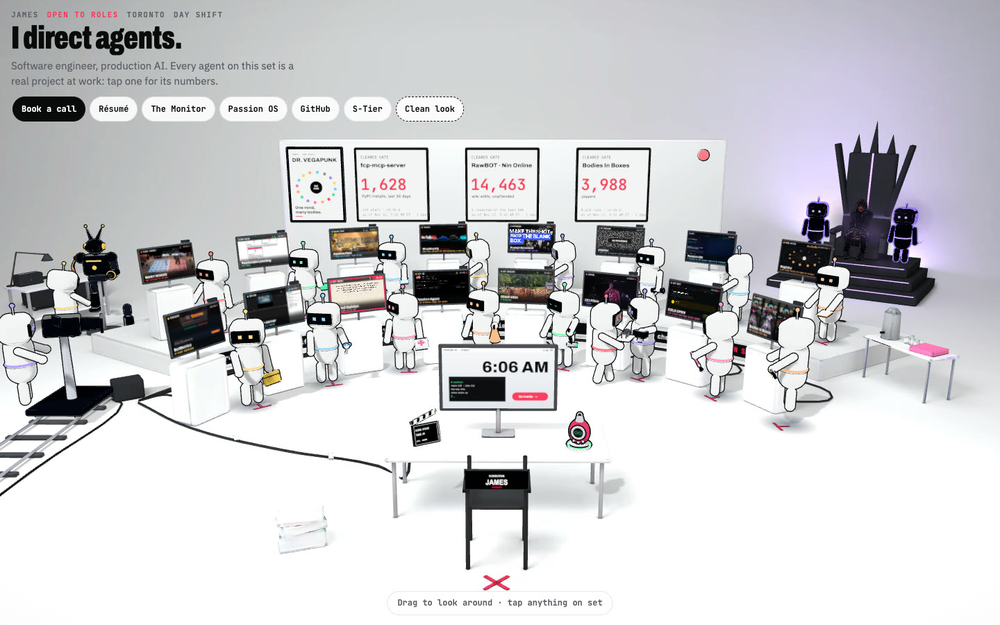
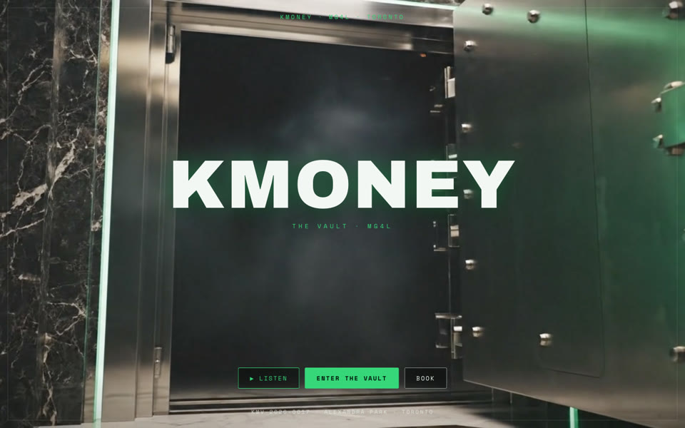
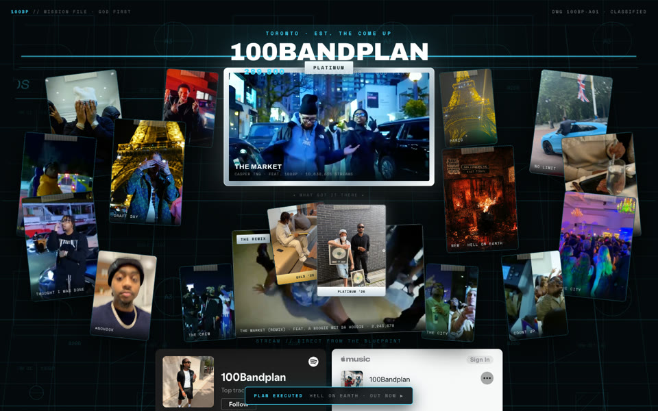
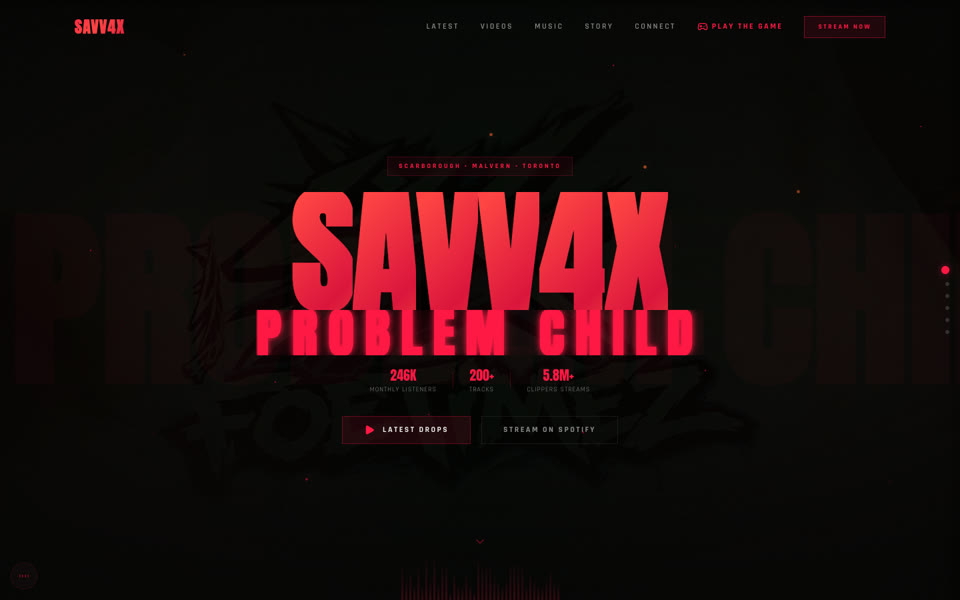
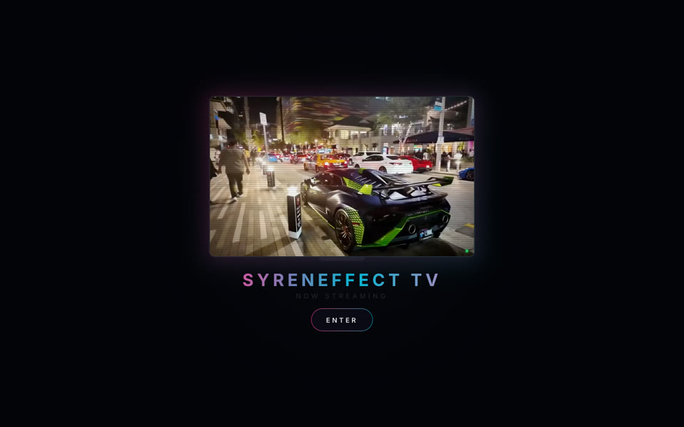
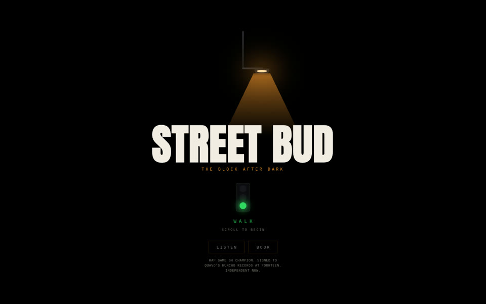
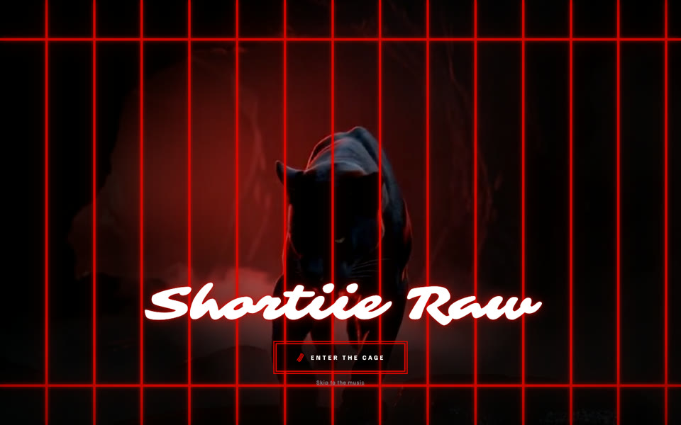

## I directed 101 music videos. Now I direct agents.

A decade behind the camera in Toronto, [101 videos](https://tdotssolutionsz.com), and Casper TNG's "Dope Boy" went [Gold](https://musiccanada.com/gold-platinum/?_gp_search=dope%20boy). The first thing I built in code was a way for Claude to cut in Final Cut Pro.

  

<b>jamesdare.com</b> is a soundstage. Every agent on set is a real project at work, and its screen shows that project's own numbers. Drag to look around. <i>Shot 2026-11-15.</i>

---

## Featured

### [fcp-mcp-server](https://github.com/DareDev256/fcp-mcp-server) · Claude cuts a real Final Cut Pro timeline

  

One sentence in. Claude reads the FCPXML, cuts the rests between sets, marks every lift, prices the B-roll and waits before spending anything, and journals every write so it can be undone. On [PyPI](https://pypi.org/project/fcp-mcp-server/) since 2026-07-25 and in the MCP registry. `defusedxml` throughout, sandboxed writes, adversarial input tests, a private disclosure channel.

Two developers outside the project sent three fixes. I merged all three: [@mikegrant25](https://github.com/mikegrant25) [#6](https://github.com/DareDev256/fcp-mcp-server/pull/6) closed a sandbox escape in `apply_template` · [@jardelapp](https://github.com/jardelapp) [#7](https://github.com/DareDev256/fcp-mcp-server/pull/7) probed audio duration instead of stamping the timeline span · [@jardelapp](https://github.com/jardelapp) [#8](https://github.com/DareDev256/fcp-mcp-server/pull/8) stopped silence detection decoding a 2.5 GB camera file whole.

**Its sibling, [frameio-to-final-cut-pro](https://github.com/DareDev256/frameio-to-final-cut-pro) (Cut Review):** client notes go into Final Cut as to-do markers on the right clips, then two exports are diffed to show which notes the recut actually touched. Free CLI and MCP server, no upload. [PyPI](https://pypi.org/project/cutreview/) · [Site](https://daredev256.github.io/frameio-to-final-cut-pro/)

### [musician-website-builder](https://github.com/DareDev256/musician-website-builder) (COLD OPEN) · six artists, six worlds, six live domains

<b>The Vault</b> K Money · <b>Mission File</b> 100Bandplan · <b>Problem Child</b> SAVV4X · <b>SyrenEffect TV</b> Syren Effect · <b>The Streetlight</b> Street Bud · <b>Carry-On</b> Shortiie Raw, the one the engine generated. <i>Shot 2026-11-15.</i>

Five built by hand. The sixth was generated by the engine the first five produced. Every build starts by naming the world the artist lives in, and type, colour, motion and section names all derive from that one decision; the build is refused if it drifts. Every number is a `Fact` that will not construct without a `sourceUrl` and a `verifiedAt`, so an unsourced claim renders as a redaction bar instead of a number.

Blind A/B, 2026-08-21: a fresh judge shown five screenshots picked a hand-built site at 70% confidence and ranked the generated one first for looking hand-made. One judge, one round, one viewport; [docs/GAUNTLET.md](https://github.com/DareDev256/musician-website-builder/blob/main/docs/GAUNTLET.md) lists what that does not cover. The engine, its guards and a [`_template`](https://github.com/DareDev256/musician-website-builder/tree/main/worlds/_template) are public; client site code is not.

### [portfolio-os](https://github.com/DareDev256/portfolio-os) · the source of jamesdare.com

The soundstage at the top of this page. Vanilla Three.js, no framework. The set is modelled in Blender and baked headless by a script in the repo, and each station's screen is fed from its project's commit history. The desktop OS that used to be the homepage still boots at [/os](https://jamesdare.com/os).

## Currently

<!-- DAILY_STATUS_START -->
| Latest release | Latest commit | fcp-mcp-server CI |
| --- | --- | --- |
| [fcp-mcp-server `v0.33.0`](https://github.com/DareDev256/fcp-mcp-server/releases/tag/v0.33.0) 2026-11-14 | [portfolio-os `0fc30ac`](https://github.com/DareDev256/portfolio-os/commit/0fc30ac33c3583eba42f235afc4c6428d61816b3) chore(data): publish live figures (2026-11-15 14:42 UTC) 2026-11-15 | [Tests: passing](https://github.com/DareDev256/fcp-mcp-server/actions/runs/43720135120) 2026-11-15 |

Generated 2026-11-15 from the GitHub API by [build_readme.py](https://github.com/DareDev256/DareDev256/blob/main/.github/scripts/build_readme.py).
<!-- DAILY_STATUS_END -->

---

## Hackathons

- **[One Lesson](https://github.com/DareDev256/one-lesson)** · *Teach one robot. Every robot learns. Undo it in one click.* Governed skill memory for robot fleets on MongoDB Atlas, taught and asked by voice. **[Finalist](https://cerebralvalley.ai/e/mongodb-toronto-hackathon/hackathon/gallery), top 6 of 98.** MongoDB Agents in Context, Toronto, Nov 2026 · solo · [Live →](https://onelesson.jamesdare.com)
- **[Real One](https://github.com/DareDev256/real-one)** · *Phone performance in, music video out. The artist is never generated.* SAM 3.1 cuts the artist out, Muse Image builds the worlds, Muse Wonder directs. Meta Global AI Dev Hackathon, Oct 2026 · [Watch →](https://real-one-watch.vercel.app)
- **[chain-recall](https://github.com/DareDev256/chain-recall)** · an arrival brief for luxury hotel front desks, reading the guest history a chain already pays Oracle OPERA to keep. Rosewood Hospitality 2030, May 2026 · 8 hours · with [Joshua Dare](https://github.com/Waleee7) · [Live →](https://chain-recall.vercel.app)
- **second-opinion** · an evidence-grounded appointment brief for adenomyosis patients, every claim with its citation. Built with Opus 4.7, Apr 2026 · repo private, demo open · [Live →](https://second-opinion-eta.vercel.app)

One Lesson: same words, two homes, two lessons.

---

## Open to

**Implementation** · **Client Solutions** · **Solutions Engineering** · **Developer Relations** · Toronto or remote

TypeScript · Python · Node · React · Next.js · Three.js · MCP · SQLite · Playwright

---

<strong>Passionate Learning: one open-source learning game, 9 worlds</strong>

The six AI literacy games plus Circuit Prophet, NetRunner and TypeMaster merged into **one installable app**: one profile, ranks E to S, FSRS spaced repetition across every world, Kumon-style mastery gates, a daily quest, no streak to lose. Drawn in a hand-coded stickman style. A new world is one data file.

**[Play →](https://passionate-learning.vercel.app)** · **[Build a world →](https://github.com/DareDev256/passionate-learning)** (MIT)

<strong>The six artists behind COLD OPEN</strong>

| Site | The world | The artist |
|---|---|---|
| **[officialkmoney.com](https://officialkmoney.com)** | The Vault | **K Money** · [Instagram](https://www.instagram.com/kmoneyyymusic/) · [YouTube](https://www.youtube.com/@Menace4Money) · [Spotify](https://open.spotify.com/artist/3WC4zw6QqkpKgs9rqk6ot6) |
| **[100bandplan.com](https://100bandplan.com)** | Mission File | **100Bandplan** · [Instagram](https://www.instagram.com/100bandplann/) · [YouTube](https://www.youtube.com/@100Bandplan) · [Spotify](https://open.spotify.com/artist/54gXMsMsoa0quu4bwTms8v) |
| **[savv4x.com](https://savv4x.com)** | Problem Child | **SAVV4X** · [Instagram](https://www.instagram.com/savv4x/) · [YouTube](https://www.youtube.com/@Savv4x) · [Spotify](https://open.spotify.com/artist/6ljuVTdHjv6rz6QLiNXg2r) |
| **[syreneffect.com](https://syreneffect.com)** | SyrenEffect TV | **Syren Effect** · [Instagram](https://www.instagram.com/syreneffect) · [YouTube](https://www.youtube.com/@syreneffect) · [TikTok](https://www.tiktok.com/@syren.effect) |
| **[officialstreetbud.com](https://officialstreetbud.com)** | The Streetlight | **Street Bud** · [Instagram](https://www.instagram.com/streetbud_/) · [YouTube](https://www.youtube.com/channel/UCkKhQTvBYCfC8aRMeE0peuQ) · [Spotify](https://open.spotify.com/artist/6tQmUQ1aBbgQwEqXFjVwB6) |
| **[shortiieraw.com](https://shortiieraw.com)** *(generated)* | Carry-On | **Shortiie Raw** · [Instagram](https://www.instagram.com/shortiieraw/) · [YouTube](https://www.youtube.com/@ShortiieRaw) · [Spotify](https://open.spotify.com/artist/0WnHD0zH7mlYxetaIYvMBO) |

<strong>Other projects</strong>

| Project | What it is | |
|---|---|---|
| [Ultimate Image & Video Prompt Generator](https://github.com/DareDev256/Ultimate-Image-Video-Prompt-Generator) | A prompt workbench for nine generation engines, stills and motion. Nine incompatible parameter grammars normalized into one wizard. Every suggestion is credited to the creator it came from. | [Live →](https://prompts.tdotssolutionsz.com) |
| [music-time-machine](https://github.com/DareDev256/music-time-machine) | Was Playing. Name a song you lived with and fly back through every Hot 100 #1 to the week it was playing, then land in its era. | [Live →](https://music-time-machine.vercel.app) |
| [disease-outbreak-map](https://github.com/DareDev256/disease-outbreak-map) | Global disease surveillance dashboard on WHO data. Mapbox GL, Supabase, Next.js. | [Live →](https://pulsemap-three.vercel.app) |
| [rag-system-with-citations](https://github.com/DareDev256/rag-system-with-citations) | RAG pipeline that returns the chunk behind every answer, so retrieval can be checked. | |
| [llm-evaluation-harness](https://github.com/DareDev256/llm-evaluation-harness) | Regression testing for LLM systems: rule-based, semantic, and LLM-as-judge scoring, wired for CI. | |
| [clickfix-protection-macos](https://github.com/DareDev256/clickfix-protection-macos) | macOS anti-infostealer toolkit, written after a real ClickFix attack came at me. Blocks `curl \| sh` paste attacks and audits what already ran. | |
| [toronto-open-data-map](https://github.com/DareDev256/toronto-open-data-map) | Toronto City Pulse: parking enforcement, TTC vehicles, bike share, closures and collisions on one 3D map. deck.gl and MapLibre. | [Live →](https://toronto-parking-viz.vercel.app) |
| [hand-tracking-playground](https://github.com/DareDev256/hand-tracking-playground) | Seven exercises in spatial gesture UI. MediaPipe, React, Canvas 2D. | |
| [vector-vs-keyword-search](https://github.com/DareDev256/vector-vs-keyword-search) | Semantic vector search against BM25, side by side, on the same corpus. | |
| [jackpoint](https://github.com/DareDev256/jackpoint) | One command installs every AI coding CLI on a Mac, plus an optional offline model. | |
| [linktree-alternative](https://github.com/DareDev256/linktree-alternative) | One-tap connection card that routes straight to an action: Follow All, vCard, DM, Book, Pay. | [Live →](https://tapin-bay.vercel.app) |
| [match-3-bubble-game](https://github.com/DareDev256/match-3-bubble-game) | Match-3 bubble game: swap adjacent bubbles, pop three or more, chain the cascades. Match 4 clears a line, match 5 drops a bomb, an L or T shape fires a colour nuke. | [Play →](https://passion-pop.vercel.app) |
| [tdotssolutionsz-portfolio](https://github.com/DareDev256/tdotssolutionsz-portfolio) | Index of the music videos I directed. | [Live →](https://tdotssolutionsz.com) |
| **syreneffect-site** *(private)* | Next.js site for a Twitch streamer: stream embed, gallery, media kit, analytics admin. | [Live →](https://syreneffect.com) |
| [buildright](https://github.com/DareDev256/buildright) | Duolingo-style mobile learning for home building. React Native and Expo. | |
| [ThrowingTracker](https://github.com/DareDev256/ThrowingTracker) | Fork of Waleee7/ThrowingTracker. Training log for throwing athletes, built by Waleee7. | |

<strong>Seven bugs, with receipts. The best one: <code>int(23.976)</code> is 23.</strong>

**Every broadcast frame rate was arithmetic on the wrong timebase.** `TimeValue` built its denominators with `int(fps)`. `int(23.976)` is 23, so 3604 seconds was stored as `86410/23s` and read back as 3756.957s, a 152 second error on a number that is exact on the page. It hit 23.976, 29.97 and 59.94. Rates are exact rationals and are carried as such end to end now, through a new `rational.py`. [fcp-mcp-server #17](https://github.com/DareDev256/fcp-mcp-server/issues/17)

**A tool moved nothing and reported success.** `snap_to_beats` built its work list from spine children only. A music video hangs every visual off an audio bed as a connected clip, so on the video I was cutting the spine held one `<gap>`: 0 of 129 clips considered, and the tool reported success. It walks connected clips lane by lane now and names every cut in its report as considered, moved, already on a beat, out of reach, or skipped for a collision. [fcp-mcp-server #16](https://github.com/DareDev256/fcp-mcp-server/issues/16)

**A 200 came from the wrong file.** A page hung on its boot screen in production. Its script tag used a relative `./app.js`. At a path with no trailing slash that resolves to `/app.js`, hits the SPA rewrite, and returns `index.html` with a 200. It passed local testing because the local URL carried the trailing slash the deployed link does not. The tag is absolute now. [portfolio-os CHANGELOG 4.14.1](https://github.com/DareDev256/portfolio-os/blob/main/CHANGELOG.md)

**A banned-colour list is defeated by nudging one channel.** COLD OPEN refuses to ship a cream ground. The first version was a hex denylist, which `#F7F1E7` fails and `#F9F3E9` passes, and those are the same colour. Replaced with a test on hue, saturation, and lightness, which catches the neighbourhood around a sample, plus a `brandExemption` a caller has to justify in the call. The same audit fails a build whose lexicon contains a generic label like "Contact". [musician-website-builder/docs/DECISIONS.md](https://github.com/DareDev256/musician-website-builder/blob/main/docs/DECISIONS.md)

**Duplicate clip names silently lost their markers.** Markers were placed through a name-indexed clip dictionary, so duplicate names were last-one-wins, and interval markers landing on an earlier clip were swallowed by an `except ValueError: pass`. The fix removed the index from that path entirely, so the writer walks spine elements directly. The regression test runs against the four same-named `Interview_A` clips in the sample timeline. [fcpxml/writer.py](https://github.com/DareDev256/fcp-mcp-server/blob/main/fcpxml/writer.py)

**The zero guard was the bug.** `TimeValue.to_seconds()` carried `if denominator == 0: return 0.0`. A malformed `0/0` frame duration became a plausible zero and travelled through every downstream comparison as data. The fix deleted the fallback and rejected the value at construction, so corruption raises at the point it enters the model. [fcpxml/models.py](https://github.com/DareDev256/fcp-mcp-server/blob/main/fcpxml/models.py)

**A counter froze on a wrong number and stayed there.** `requestAnimationFrame` is suspended in a background tab, so a page opened with "open link in new tab" stalled a count-up partway and left the intermediate value on screen permanently. Observed live: a streak counter read `1` while its own `data-count` said `2`. Counters now snap to the true value on a timer, with or without the animation. [portfolio-os CHANGELOG 4.14.2](https://github.com/DareDev256/portfolio-os/blob/main/CHANGELOG.md)

<strong>What I would build differently</strong>

**I unit-tested a parser and shipped integration bugs.** fcp-mcp-server has a deep unit suite. Issues #16 and #17 both walked past all of it, because a synthetic timeline cannot show you that a real music video puts every visual on a connected clip. One was caught by an end-to-end stdio smoke test, the other by dogfooding the server on one of my own music video projects. Real files in `examples/` should have been the first test target.

**Numbers typed into a page drift.** Two plates on the portfolio-os homepage carried hardcoded wiki edit and screenshot counts, correct the day they were written and wrong by the end of that week. They are regenerated from source now.

**"No dependencies" was a claim the manifest did not make.** portfolio-os ships no frontend framework and Vite is its only build step, which is the interesting part. `package.json` still lists two runtime dependencies: `@vercel/analytics` in the browser bundle and `@anthropic-ai/sdk` in the two serverless routes under `api/`.

---

Toronto · <a href="https://jamesdare.com">jamesdare.com</a> · <a href="https://github.com/DareDev256/DareDev256">this profile's source</a>

